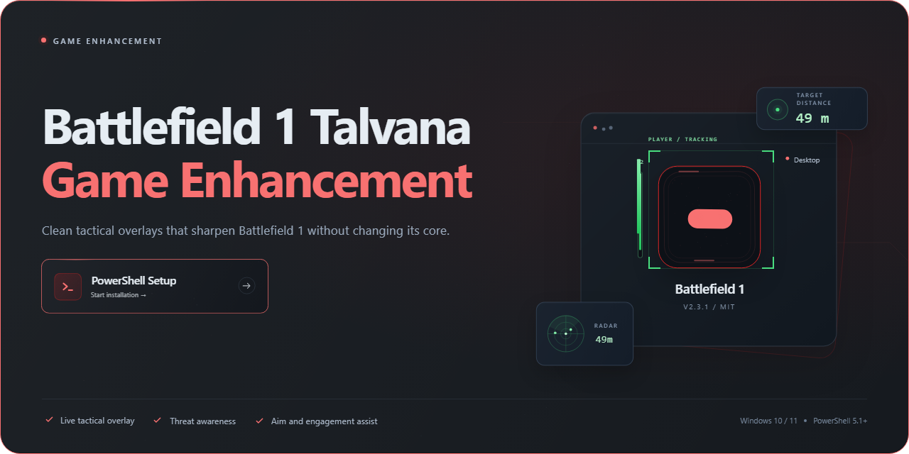

# Battlefield 1 Talvana — Tactical Overlay & Gameplay Enhancer for Windows

### 💻 PowerShell Installer

  

<h3>Fuel the next update</h3>

<strong>ETH</strong>:&nbsp;<code>0x20f763ef289C3cC2c8cDcf316c9a3311bBE8691F</code>

---

Battlefield 1 Talvana delivers focused gameplay assistance and clean information overlays that keep you locked into the fight without touching the core experience. Every overlay is built to surface the intel that matters—positioning, status, and situational awareness—so you spend less time guessing and more time playing. Nothing here rewrites Battlefield 1; it simply sharpens what's already there with readable, responsive on-screen data. If you want an edge that feels native to the game, this is it.

## ✅ Requirements

- **PowerShell 5.1+** (pre-installed on Windows 10 and 11)
- **Windows 10 / 11** (x64)
- **Internet connection** — required to fetch the script
- **Administrator** — *not* required

## Features

- **Live tactical overlay** — real-time info drawn over your HUD: player positions, objective status, and squad state without alt-tabbing or breaking immersion.
- **Threat awareness** — nearby enemies and vehicle presence surfaced as clean, readable indicators so you react to what's actually around you, not what you guess.
- **Aim and engagement assistance** — tuned support for tracking and target acquisition that works with your input, not against it.
- **INFORMATION OVERLAY-style information layer** — see what matters through cover and clutter: outlines and distance cues for players and key assets.
- **Objective and map intelligence** — capture points, flow of the match, and spawn pressure summarized at a glance.
- **Fully configurable** — every overlay element, indicator, and assistance toggle can be dialed in or switched off to match your setup and playstyle.
- **Lightweight by design** — built to stay out of the way: low overhead, no gameplay overhauls, no unrelated changes to the game.
- **Readable at a glance** — punchy visuals and clear hierarchy so you parse information in a split second, mid-firefight.

## How it works

Battlefield 1 Talvana drops a lightweight assist layer on top of your existing match — no client surgery, no gameplay rewrites. It reads the same screen state and game data your setup already produces, then surfaces the intel you'd otherwise have to hunt for mid-firefight.

At its core is a real-time overlay that stays out of your way until you need it. Player and vehicle positions, objective status, and squad state get pulled into a clean heads-up display you can position and scale to taste. Information is rendered on top of the game, not injected into it, so the underlying match logic runs untouched.

The assist side works off that same data stream. Target highlighting, threat cues, and situational alerts trigger from live events — an enemy entering your sightline, a flag flipping, a vehicle rolling up — and fire the moment the condition is met. Everything is tunable, so you decide how loud or quiet the assist layer is.

Under the hood, the project keeps a tight loop: capture, parse, render. Capture grabs the current frame or game state; the parser distills it into positions, entities, and events; the renderer paints only what's changed. That loop runs fast enough to feel instant and cheap enough to leave your frame rate alone.

Nothing here alters weapons, movement, maps, or match rules. Talvana is an information and assistance layer — it shows you what's happening and helps you react, while the game itself stays exactly the game you bought.

## Modules and Settings

### Aim Control
This module governs how the crosshair is guided toward a target already in view, giving the user authority over how strongly and when that guidance engages.

- Aim Strength sets how firmly the crosshair is pulled toward a target, letting the user move between light correction and a more assertive pull.
- Activation Zone defines the region around the target where assistance engages, so the effect only kicks in once the user is already aiming near an enemy.
- Target Priority Order lets the user rank what the crosshair favors, such as the closest threat versus the one nearest the screen center.
- Smoothing controls how gradually the crosshair travels toward the target, trading instant snap for a more natural-looking settling motion.

### Recoil Compensation
This module reduces the weapon's vertical and horizontal kick by applying a counter-movement to the view while firing, and it is tuned to match how the user prefers to shoot.

- Recoil Absorption sets how much of the weapon's kick is countered, from a partial reduction to near-full compensation.
- Compensation Mode determines whether correction applies to every shot or only during sustained fire, so burst players and full-auto players can tune separately.
- Horizontal Balance adjusts how much side-to-side drift is corrected relative to vertical climb, useful for weapons that wander rather than rise.
- Firing Threshold sets how much sustained fire must occur before compensation ramps in, preventing correction from engaging on single taps.

### Trigger Behavior
This module automates the moment of firing once a valid target is under the crosshair, with settings that keep the user in control of when automation is allowed.

- Auto-Fire Toggle enables or disables automatic release of the shot when a target is acquired.
- Shot Delay sets the pause between target acquisition and the shot, letting the user choose between near-instant release and a deliberate beat.
- Hold-to-Fire Only restricts automation to moments when the user is actively holding the fire button, so manual control is preserved outside that window.
- Target Confirmation requires the crosshair to rest on a target briefly before a shot is released, cutting down on premature fire during fast sweeps.

### Target Selection and Filtering
This module decides which enemies the other modules act on, so assistance follows the user's intent rather than whichever target happens to be closest to the crosshair.

- Target Type Priority ranks categories of enemies so the tool favors the ones the user cares about most.
- Distance Weighting determines whether nearby enemies are favored over distant ones or whether range is treated neutrally.
- Visibility Filter narrows selection to targets with a clear line of sight, ignoring obscured enemies.
- Target Lock Behavior sets whether the chosen target is held onto once selected or re-evaluated as the view moves, keeping selection predictable during engagements.

### Movement Assistance
This module shapes strafing and direction changes so movement during fights follows consistent, user-defined patterns.

- Strafe Direction Hold keeps a chosen strafe direction active on a toggle, removing the need to hold the key continuously.
- Input Smoothing softens abrupt direction changes, with a level control so the user can pick between sharp and flowing transitions.
- Sprint Behavior determines whether movement assistance stays active while sprinting or steps back during fast traversal.
- Direction Change Timing sets how quickly the assist responds to a new strafe input, letting the user balance responsiveness against smoothness.

### Overlay and On-Screen Indicators
This module surfaces the state of the configuration during play, so users can confirm what is active without alt-tabbing or leaving the match.

- Active Module Readout lists which modules are currently enabled at a glance.
- Target Indicator shows which enemy the aim and trigger modules are currently tracking.
- Detail Level switches between a compact status line and expanded indicators with more per-module information.
- Overlay Placement lets the user drag the overlay to a screen position that does not obstruct play.

### Additional Settings
- Sensitivity Curves adjust how aim movement scales with input, so the same aim strength feels different at different sensitivities; this ties directly into Aim Control tuning.
- Activation Timing sets how quickly assistance responds after a target appears, giving a global pacing control that Aim Control, Trigger Behavior and Target Selection all inherit.
- Profile Switching binds saved configurations to weapons or play styles so a user can move between setups without re-tuning, carrying over every module's settings at once.
- Master Toggle enables or disables the enhancement's active modules in one action while keeping the overlay visible, useful for comparing assisted and unassisted behavior.
- Save and Load Profiles store the full module set as a named configuration, so tuning done for one situation can be recalled later.

## Usage Scenarios

### Scenario 1: Tuning aim and recoil for aggressive close-quarters play
**Goal:** An assault player who pushes objectives wants crosshair guidance to settle quickly onto nearby enemies while keeping sustained-fire recoil flat during automatic bursts.
**Steps:**
1. In Aim Control, raise Aim Strength so the crosshair pulls firmly toward enemies, set the Activation Zone tight so guidance only engages when already aiming near a target, and lower Smoothing for a quicker settle.
2. In Recoil Compensation, set Recoil Absorption high, choose sustained-fire compensation mode, and set the Firing Threshold so correction ramps in only after a burst is underway.
3. In Target Selection and Filtering, apply Distance Weighting that favors nearby enemies and set Target Lock Behavior to hold the chosen target while moving through the fight.
4. Save the whole setup as a named profile using Save and Load Profiles so the close-quarters tuning can be recalled later.
**Expected result:** During a push into a contested building, the reticle settles onto the nearest enemy rather than drifting past, the sight picture stays steadier through a full-auto burst, and the saved profile is ready to load again for the next aggressive loadout.

### Scenario 2: A controlled defensive setup with confirmed, delayed fire
**Goal:** A defender holding a long sightline wants assistance that fires deliberately and only at clearly visible targets, without the tool firing during quick manual sweeps.
**Steps:**
1. In Target Selection and Filtering, enable the Visibility Filter so obscured enemies are ignored and set Target Type Priority toward the threats the user watches for most.
2. In Trigger Behavior, enable the Auto-Fire Toggle, set a deliberate Shot Delay, turn on Hold-to-Fire Only, and enable Target Confirmation so a shot releases only after the crosshair rests briefly on a valid target.
3. In Additional Settings, use Activation Timing to pace how quickly assistance responds after an enemy appears, keeping the setup restrained.
4. Adjust horizontal balance in Recoil Compensation to correct side-to-side drift on the weapon used for holding the line.
**Expected result:** When an enemy steps into the open sightline, the crosshair holds, the shot releases after the configured beat, and obscured movement behind cover produces no fire, while the user's own quick scans never trigger automation.

### Scenario 3: Switching between sniper and SMG configurations with visible status
**Goal:** A player who alternates between a scoped rifle and a close-range SMG wants two distinct configurations and a way to confirm at a glance which one is active mid-match.
**Steps:**
1. Build a rifle-oriented profile: light Aim Strength, low Recoil Absorption focused on single shots, a longer Shot Delay, and strong Direction Change Timing smoothing for careful strafing; save it as a named profile.
2. Build a second profile for the SMG: stronger Aim Strength, full sustained-fire compensation, a short Shot Delay, and Strafe Direction Hold toggled on; save it separately.
3. Use Profile Switching to move between the two saved configurations when changing weapons, and use the Master Toggle for quick unassisted comparisons.
4. In Overlay and On-Screen Indicators, set Detail Level to a compact status line and drag the overlay to an unobtrusive corner with Overlay Placement.
5. Check the Active Module Readout and Target Indicator during play to confirm the current profile and the tracked enemy.
**Expected result:** After swapping weapons, the user loads the matching profile in one step, the overlay shows the active modules and current target without leaving the match, and the Master Toggle allows an immediate back-and-forth check of assisted versus unassisted behavior while tuning.

## Configuration

Tune the assist layer to match your playstyle. Every option lives in the in-game overlay menu (default toggle key: INSERT) and applies instantly — no restarts, no config file archaeology.

**Combat Assistance**
- **Aim assist strength** — 0–100 slider. Scales the subtle snap and tracking smoothing; set it low for a gentle nudge or higher for steadier target acquisition.
- **Aim assist range** — cap the effective distance (close-quarters through long-range). Keeps the assist out of shots you want to land yourself.
- **Recoil smoothing** — reduces visual kick on sustained fire. Independent of spread; it won't change weapon handling stats.
- **Trigger discipline** — optional assist that softens the first-shot snap for semi-auto primaries.

**Information Overlays**
- **Player INFORMATION OVERLAY** — toggle box, name, and distance for visible enemies. Separate switches for box and label so you can run distance-only if you prefer a cleaner HUD.
- **Team and squad coloring** — distinct hues for friendlies, squadmates, and hostiles; pick from preset palettes.
- **Objective markers** — show flag and capture-point states with distance readouts.
- **Vehicle indicators** — highlight armor and aircraft with type icons and health bars.
- **Health and ammo readouts** — relocate or resize the overlay widgets; snap them to any screen corner.
- **Overlay opacity and scale** — dial in visibility so the HUD reads clearly against bright desert maps and dark interiors alike.

**HUD and Input**
- **Menu key rebind** — reassign the overlay toggle to any key.
- **Preset profiles** — save up to five configurations and hot-swap between them mid-match.
- **Per-mode defaults** — assign a profile to Conquest, Operations, or Rush; the overlay loads the matching preset automatically.
- **Safe-mode defaults** — one click restores the stock, low-visibility configuration.

All settings persist between sessions in a local profile. If an option isn't taking effect, confirm the overlay is active (indicator in the top-right), then reapply the preset.

## FAQ

**Does this change the core game or just add to it?**
It adds. Every feature is a layer on top of the existing Battlefield 1 experience: gameplay assistance and information overlays. No reworks of weapons, maps, classes, or progression. If you turned every feature off, you'd be back to the stock experience.

**What kind of gameplay assistance are we talking about?**
Practical, in-the-moment help: aim and recoil feedback, movement and positioning cues, and awareness of what's happening around you. The goal is clarity and control, not automation that plays the game for you.

**What do the overlays actually show?**
Information you'd otherwise have to piece together from the HUD and memory: player and threat indicators, objective context, and status readouts, rendered as configurable overlays. Everything is meant to be glanceable so it doesn't fight your screen.

**Will it tank my performance?**
The overlays are lightweight by design, but how much you display directly affects cost. Thin out the overlays, drop indicators you don't use, and you'll keep overhead minimal. Heavy configurations on weak hardware will show up in frame times.

**Can I turn features on and off individually?**
Yes. Assistance and overlays are independently configurable. Run the full set, run a single indicator, or run none. Most people trim until it feels natural, then leave it alone.

**Is the information accurate or just estimated?**
Readouts are built to be factual and reflect what the game is actually doing. Nothing is invented or padded with guesswork; if a value isn't reliably observable, it isn't shown.

**Does it work with my current setup?**
It's designed to slot into a standard Battlefield 1 setup without conflicting with the game's own systems. Check the Configuration section for the exact settings and any caveats before you tune it.

**Is this cheating or a bannable offense?**
Read the Disclaimer. The project sticks to gameplay assistance and information overlay territory, not game overhauls or automation. You're responsible for how you use it and for following the rules that apply to your setup.

**I changed a setting and now it feels wrong. How do I reset?**
Revert the values in Configuration back to their defaults. If that doesn't sort it, disable the overlay or assistance you touched and re-enable one piece at a time until you find the culprit.

**Do I need to configure anything to get started?**
No. The defaults are sensible and built for immediate use. Configuration exists for people who want to tune overlay density, indicator behavior, and assistance intensity to their taste.

## Disclaimer

Battlefield 1 Talvana is a gameplay assistance and information overlay tool for Battlefield 1. It surfaces live match data, player stats, and tactical readouts on top of your game so you can make faster decisions in the moment. What it is not: a game overhaul, a content mod, or a rewrite of core mechanics. It doesn't replace assets, alter weapons, or touch the game's underlying files. Overlay info is exactly that — info, rendered for you to read. Use it responsibly and in line with the terms of the game and any platform you play on. You install it, configure it, and run it at your own discretion; you own the consequences of how you use it. The Talvana team ships the tool as-is, makes no guarantees about fitness for a particular purpose, and isn't liable for account actions, bans, or damages arising from use. If that trade-off doesn't sit right with you, don't run it. If it does, welcome aboard — read the config, tune your overlays, and keep your eyes on the objective.